# Lumina Dental Care: WordPress local-service site

A dental-clinic website built as a custom WordPress theme + companion plugin, with a Zara-inspired editorial
design: monochrome, Didone serif display type, hairline rules and full-bleed video. No page builder.

> **Concept / demo build.** The clinic, prices, dentist and reviews are placeholders (reviews are labelled "Sample").
> Photos are from Pexels and video from Mixkit: see [CREDITS](wp-content/themes/lumina-dental/assets/CREDITS.md).

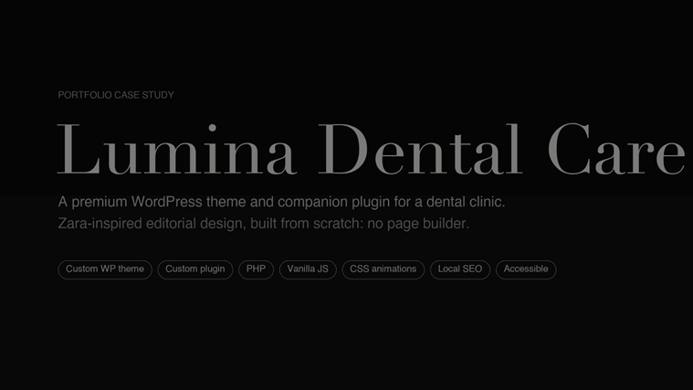

**[▶ Watch the full 2½-minute walkthrough](portfolio/video/lumina-dental-walkthrough.mp4)**
 · [All screenshots](portfolio/screenshots/) · [Portfolio notes](portfolio/README.md)

<p align="center">
<a href="portfolio/screenshots/00-portfolio-cover-light.jpg">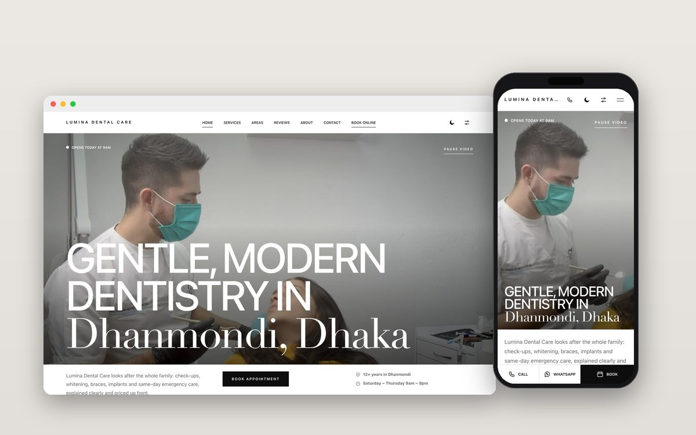</a>
<a href="portfolio/screenshots/00-portfolio-cover-dark.jpg">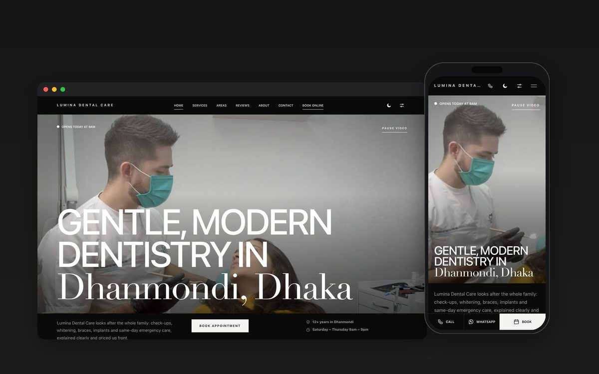</a>
</p>

## Preview

Click any image for the full-size screenshot.

### Highlights

<table>
<tr><td width="50%" valign="top"><a href="portfolio/screenshots/01-home-hero-light.jpg">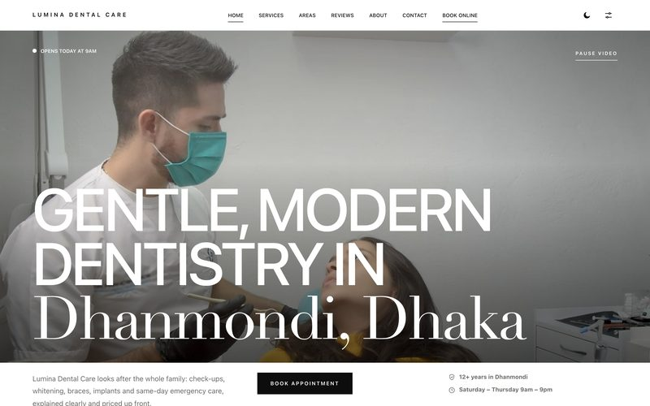</a><br><sub><b>Full-bleed video hero with live open-now status</b></sub></td><td width="50%" valign="top"><a href="portfolio/screenshots/02-home-hero-dark.jpg">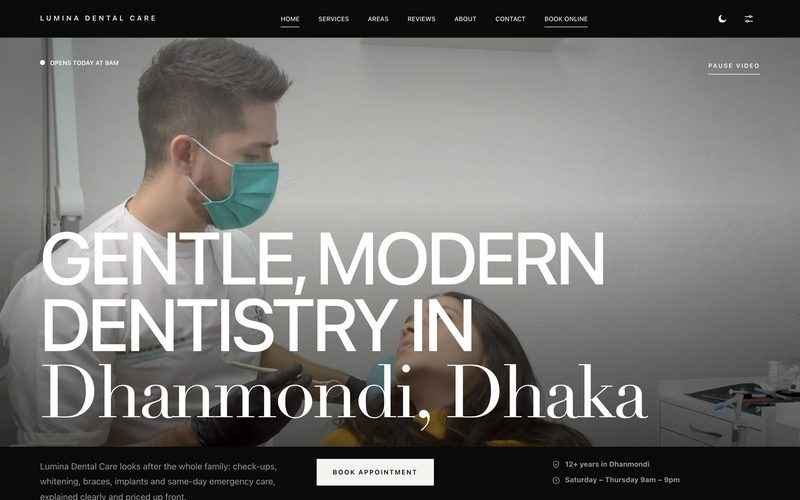</a><br><sub><b>Dark theme: same design, one token swap</b></sub></td></tr>
<tr><td width="50%" valign="top"><a href="portfolio/screenshots/03-scroll-lit-headline-light-stage2.jpg">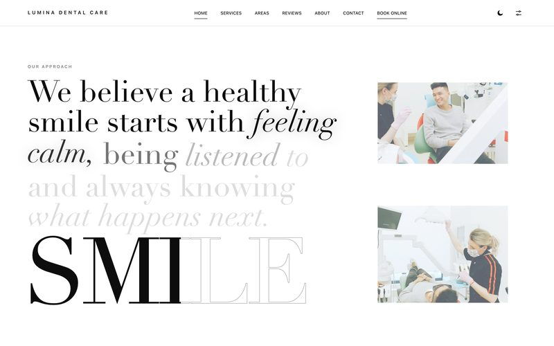</a><br><sub><b>Scroll-lit headline: words light up as you scroll</b></sub></td><td width="50%" valign="top"><a href="portfolio/screenshots/04-treatments-index-hover-light.jpg">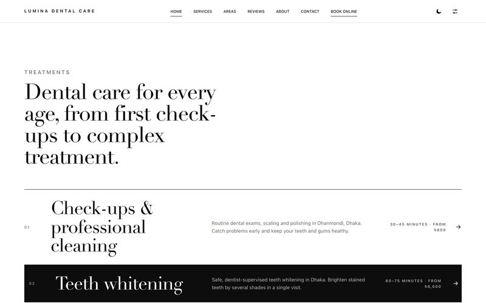</a><br><sub><b>Numbered treatments index with hover state</b></sub></td></tr>
<tr><td width="50%" valign="top"><a href="portfolio/screenshots/05-counters-and-standard-light.jpg">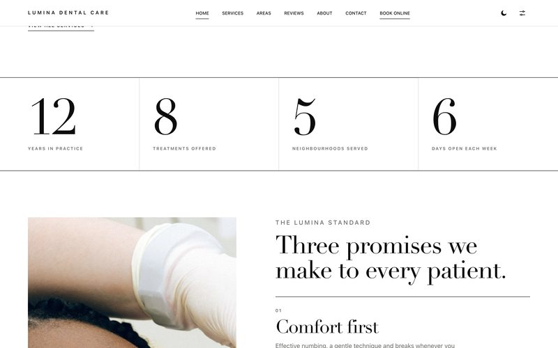</a><br><sub><b>Animated counters, fed by live clinic data</b></sub></td><td width="50%" valign="top"><a href="portfolio/screenshots/08-whitening-video-band.jpg">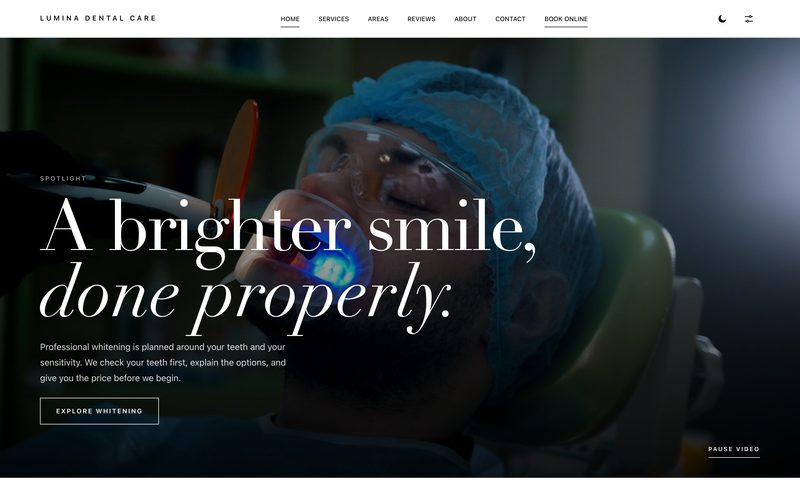</a><br><sub><b>Whitening spotlight: video band with pause control</b></sub></td></tr>
<tr><td width="50%" valign="top"><a href="portfolio/screenshots/09-safety-and-technology.jpg">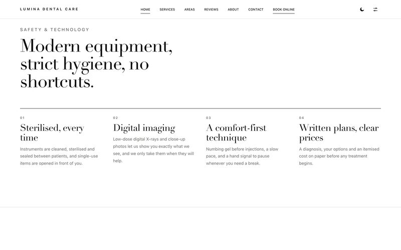</a><br><sub><b>Safety and technology, from one editable module</b></sub></td><td width="50%" valign="top"><a href="portfolio/screenshots/10-team-section.jpg">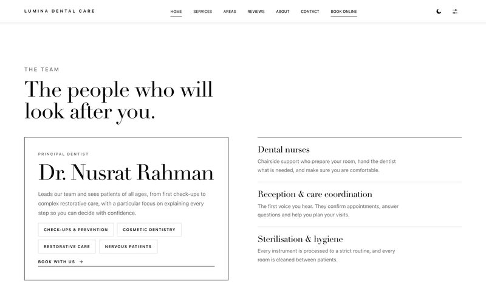</a><br><sub><b>Team section pulls the dentist from clinic settings</b></sub></td></tr>
<tr><td width="50%" valign="top"><a href="portfolio/screenshots/13-faq-accordion-open.jpg">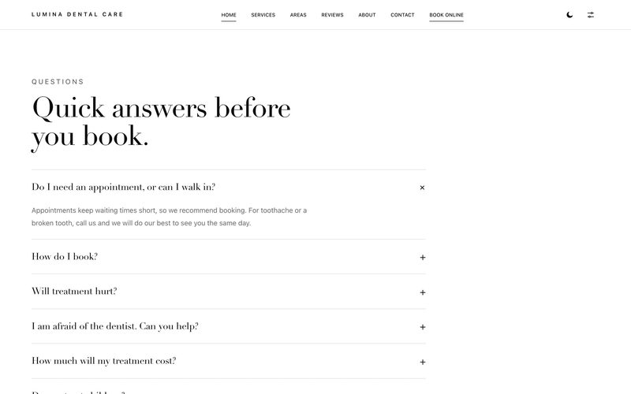</a><br><sub><b>FAQ accordion: native details, no JavaScript</b></sub></td><td width="50%" valign="top"><a href="portfolio/screenshots/14-closing-cta-hover.jpg">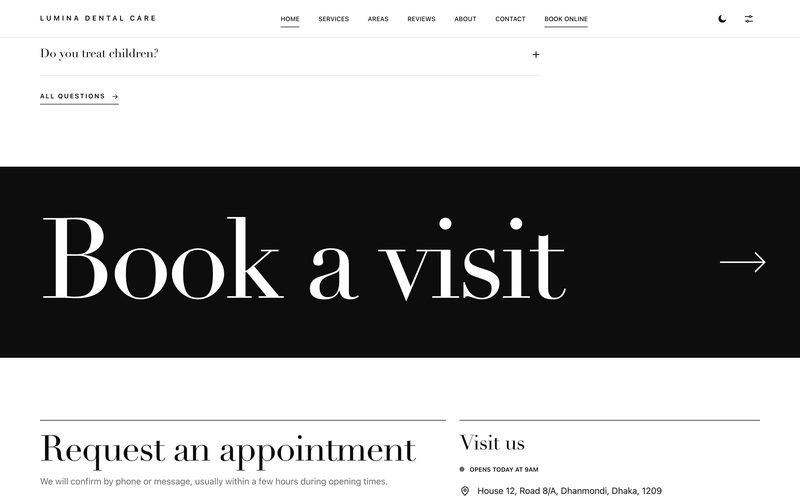</a><br><sub><b>Closing call to action</b></sub></td></tr>
<tr><td width="50%" valign="top"><a href="portfolio/screenshots/15-display-settings-panel.jpg">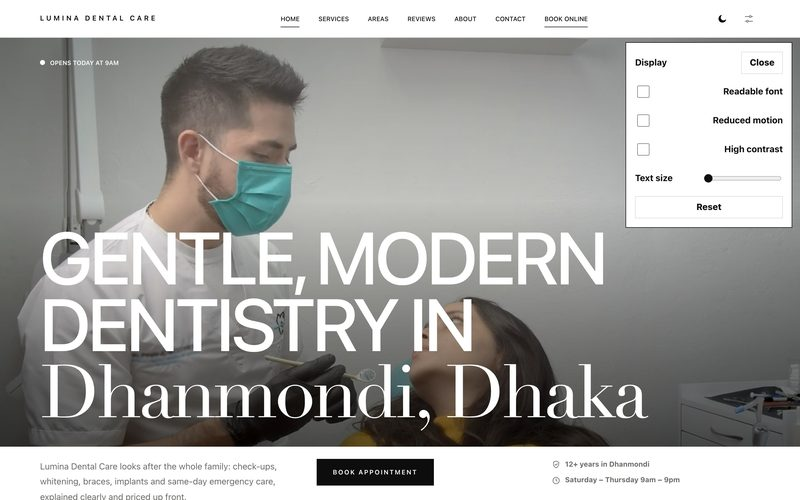</a><br><sub><b>Accessibility display panel</b></sub></td><td width="50%" valign="top"><a href="portfolio/screenshots/16-high-contrast-mode.jpg">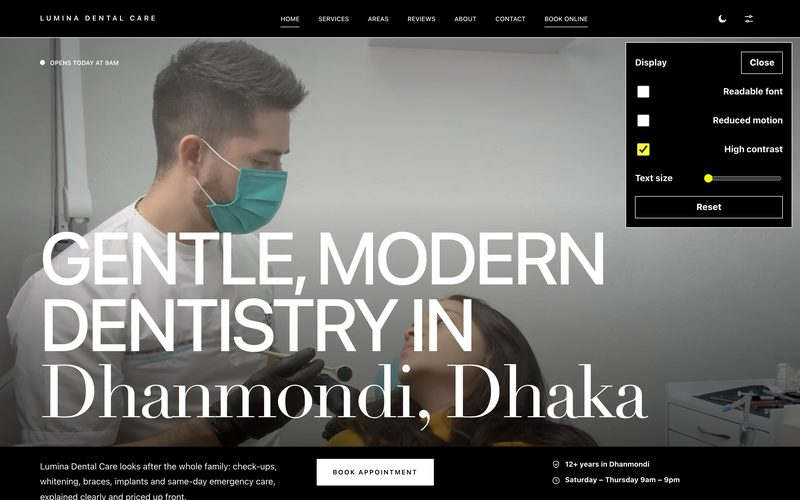</a><br><sub><b>High-contrast mode</b></sub></td></tr>
</table>

### Pages

<table>
<tr><td width="50%" valign="top"><a href="portfolio/screenshots/20-fullpage-about-light.jpg">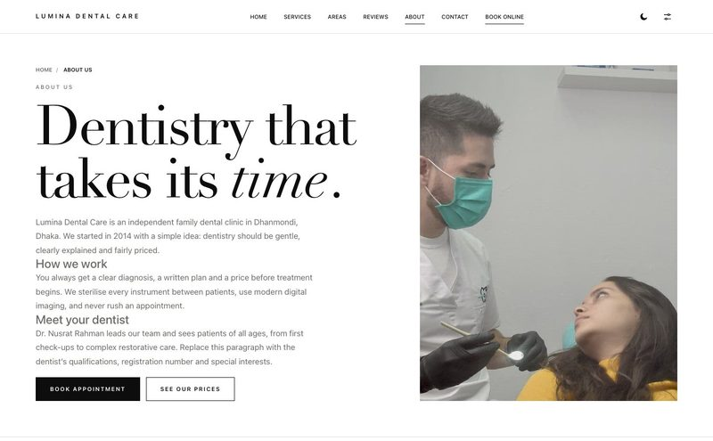</a><br><sub><b>About</b></sub></td><td width="50%" valign="top"><a href="portfolio/screenshots/20-fullpage-prices-light.jpg">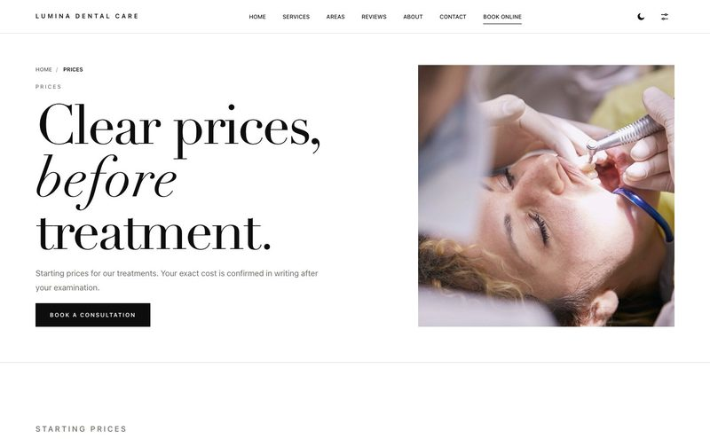</a><br><sub><b>Prices (built from each service's own price field)</b></sub></td></tr>
<tr><td width="50%" valign="top"><a href="portfolio/screenshots/20-fullpage-service-detail-light.jpg">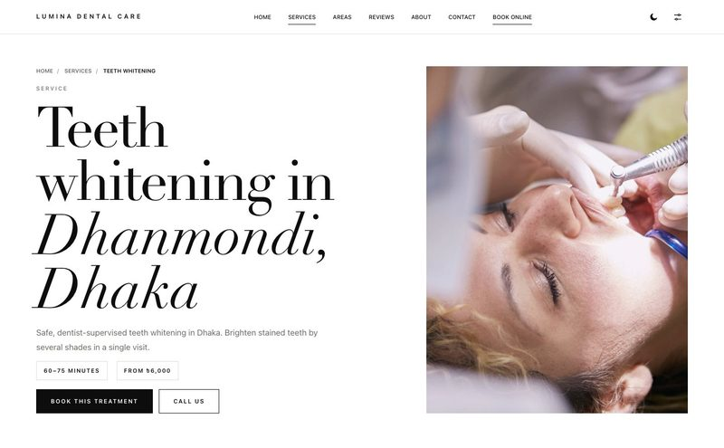</a><br><sub><b>Treatment page: steps, FAQs, aftercare, reviews</b></sub></td><td width="50%" valign="top"><a href="portfolio/screenshots/20-fullpage-faqs-light.jpg">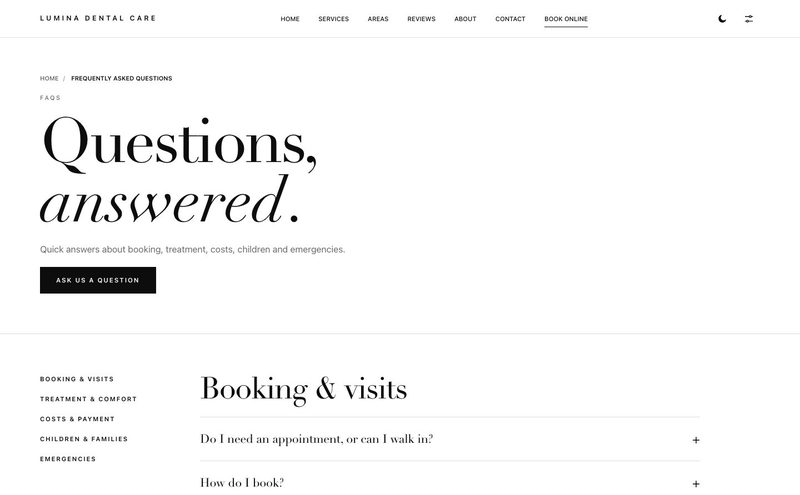</a><br><sub><b>FAQ page with sticky jump list</b></sub></td></tr>
<tr><td width="50%" valign="top"><a href="portfolio/screenshots/20-fullpage-areas-light.jpg">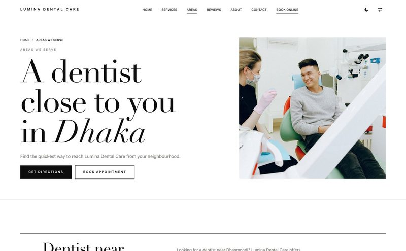</a><br><sub><b>Areas we serve (local SEO)</b></sub></td><td width="50%" valign="top"><a href="portfolio/screenshots/20-fullpage-contact-light.jpg">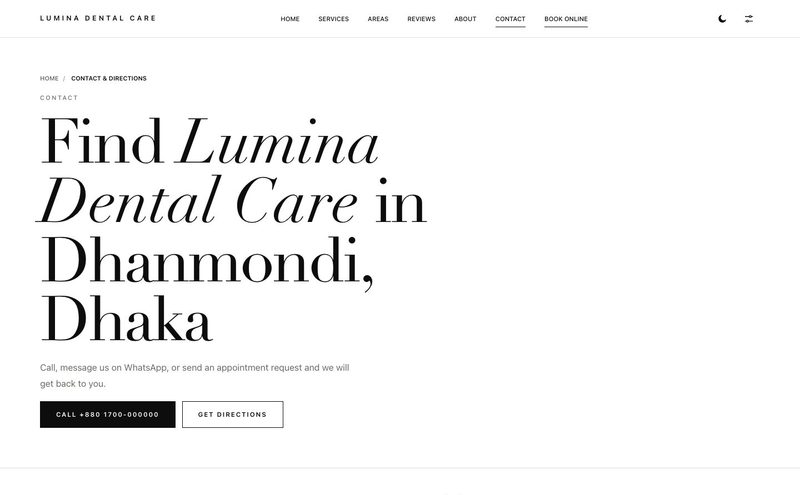</a><br><sub><b>Contact and booking</b></sub></td></tr>
</table>

### Mobile

<table>
<tr><td valign="top" align="center"><a href="portfolio/screenshots/30-mobile-home-hero.jpg">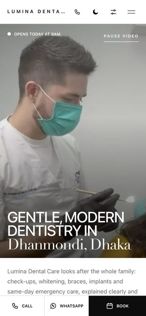</a><br><sub><b>Home</b></sub></td><td valign="top" align="center"><a href="portfolio/screenshots/31-mobile-slide-in-menu.jpg">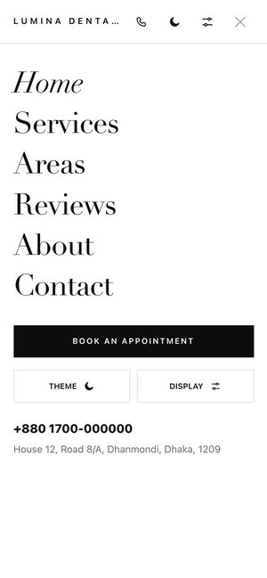</a><br><sub><b>Menu</b></sub></td><td valign="top" align="center"><a href="portfolio/screenshots/32-mobile-display-settings.jpg">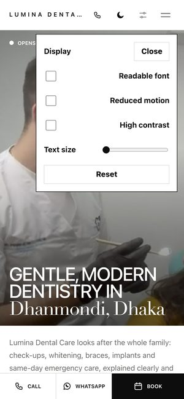</a><br><sub><b>Display panel</b></sub></td><td valign="top" align="center"><a href="portfolio/screenshots/33-mobile-scroll-lit-headline.jpg">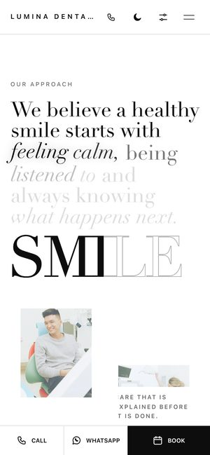</a><br><sub><b>Scroll-lit</b></sub></td><td valign="top" align="center"><a href="portfolio/screenshots/34-mobile-treatments-index.jpg">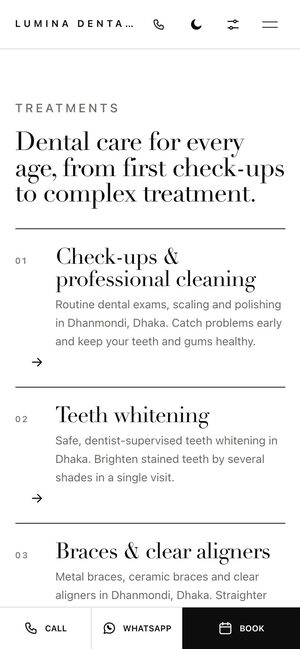</a><br><sub><b>Treatments</b></sub></td><td valign="top" align="center"><a href="portfolio/screenshots/35-mobile-booking-form.jpg">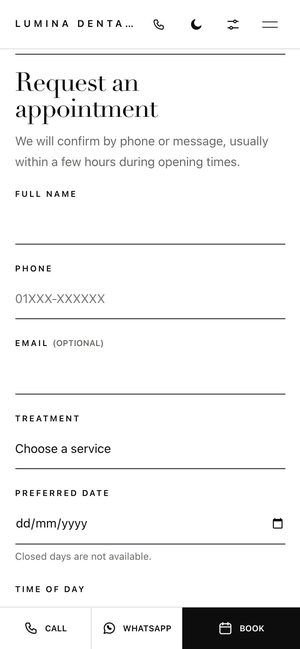</a><br><sub><b>Booking</b></sub></td></tr>
</table>

### Built with

Custom theme and plugin in PHP · vanilla JS and CSS (one CSS variable drives the scroll animations) · services, areas and
reviews as custom post types · booking form with honeypot, rate limit and server-side validation · JSON-LD schema,
breadcrumbs and per-neighbourhood pages · light/dark themes and an accessibility panel · respects reduced-motion and Save-Data.

## Structure

```
wp-content/themes/lumina-dental/         presentation: templates, CSS, JS (no build step)
wp-content/plugins/lumina-clinic-core/   content types, clinic settings, schema, booking, starter content
```

## Run it in XAMPP

1. Start Apache and MySQL in the XAMPP control panel.
2. In phpMyAdmin create a database named `lumina_dental` (collation `utf8mb4_general_ci`).
   Copy `wp-config.example.php` to `wp-config.php` (XAMPP defaults: user `root`, empty password) and replace the
   placeholder keys with fresh ones from <https://api.wordpress.org/secret-key/1.1/salt/>. `wp-config.php` is git-ignored.
3. Open `http://localhost/untitled%20folder/` and finish the WordPress install screen.
   (Tip: rename the folder to `lumina-dental` first to avoid the space in the URL.)
4. Appearance → Themes → activate **Lumina Dental**.
5. Plugins → activate **Lumina Clinic Core**. This creates the starter content, the menu,
   sets the Dhaka time zone and `/%postname%/` permalinks.
6. Fill in **Clinic → Clinic details** with the real name, address, phone, hours, coordinates.

## What is where

| Need | Where |
| --- | --- |
| Name, address, phone, hours, map pin | Admin → Clinic |
| Treatments (one page each, with FAQs and steps) | Admin → Services |
| Neighbourhood landing pages | Admin → Areas served |
| Reviews | Admin → Reviews |
| Booking requests | Admin → Appointments (also emailed) |
| Menu | Appearance → Menus (location: Primary) |

## Local SEO built in

- City-qualified titles and meta descriptions (`/services/teeth-whitening/` → "Teeth whitening in Dhaka | …").
- One H1 per page, breadcrumbs matching `BreadcrumbList` markup, canonical URLs.
- JSON-LD: `Dentist`/`LocalBusiness` (NAP, geo, hours, areas), `Service`, `FAQPage`, `BreadcrumbList`.
- Service pages and per-neighbourhood pages, all in WordPress's built-in `/wp-sitemap.xml`.
- NAP is stored once and reused everywhere, so it cannot drift between pages.
- The theme stands down its own title/meta tags if Yoast, Rank Math or AIOSEO is active.

## Before you launch

- **Replace the sample reviews.** They are labelled "Sample" on the page and are deliberately
  *excluded* from star-rating markup. Fabricated ratings break Google's policies and consumer law.
  Untick "Sample review" once a review is real. The rating badge and `aggregateRating` then appear.
- Replace placeholder copy, prices (৳), dentist details and the trust-strip claims on the home page
  with statements that are true for the clinic.
- Email: XAMPP does not send mail by default. Requests are always saved under Appointments;
  install an SMTP plugin (e.g. WP Mail SMTP) so notifications also reach the inbox.
- Add a privacy policy page; booking collects name, phone and optional email.
- Google Maps only loads after a visitor taps "Show map".

## Booking form

Posts to `admin-post.php?action=lumina_book`. Works with or without JavaScript. Protected by a
hidden honeypot, a signed time token, a 5-per-hour limit per IP and server-side validation
(closed days from your opening hours, 90-day window, service must exist).
